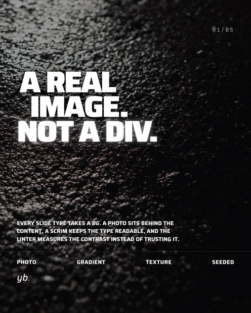
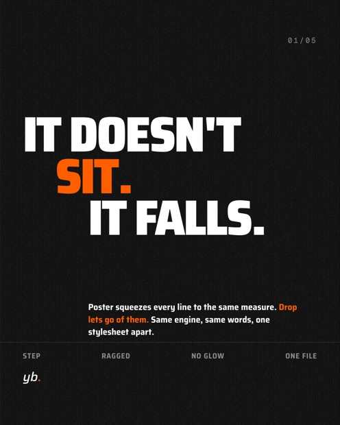
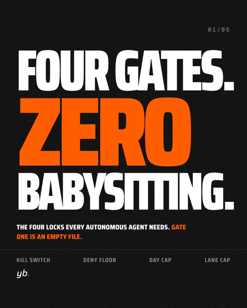
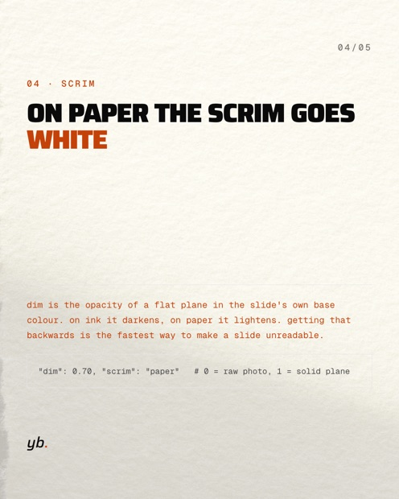
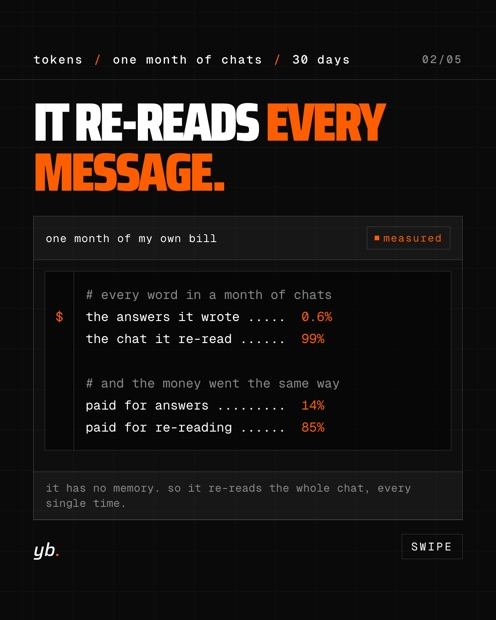
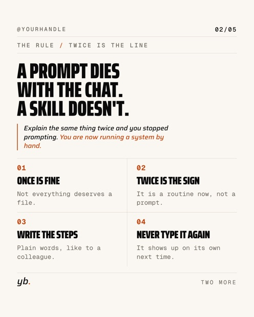

# carousel-engine

Text in, carousel out. A deck is a JSON file; the engine renders it to
1080×1350 PNGs on your own machine, in a headless browser, byte-identically
every time.

| | | |
|---|---|---|
|  |  |  |
|  |  |  |

Every slide above came out of `examples/`. Nothing was retouched, nothing was
placed by hand, and the two with a photograph behind the type are the same
mechanism as the four without one.

No image model. This design system is specified down to the pixel, and a
diffusion model will misspell something across eight information slides.
Rendered HTML is exact, reproducible, versionable, and costs nothing to run.

## Five minutes

```bash
python3 -m pip install playwright && python3 -m playwright install chromium
python3 render.py --deck examples/014-mix.json --out out/
python3 lint.py   --deck examples/014-mix.json
```

Playwright is the only dependency for rendering, linting and animating.
Everything else is the Python standard library. The fonts ship with the repo,
so a render never touches the network.

The one exception is `tokens/make-textures.py`, which regenerates the six
surface tiles and needs `numpy` and `Pillow`. You never have to run it: the
tiles it produces are committed.

## Make it yours

1. `tokens/brand.json` sets your wordmark, handle and day zero.
2. `tokens/tokens.css` is the whole palette and both faces, in one file.
3. Copy an example deck, change the words, render, lint, post.

If you would rather not edit the files the repo ships, put your palette and
your `@font-face` blocks in `tokens/brand.local.css`. The renderer loads that
file last if it exists, so it beats `tokens.css` and every look. It is
gitignored, so it survives a `git pull` and never travels with a fork.

## What is in here

| Path | What |
|---|---|
| `render.py` | deck.json to PNGs, via Playwright and headless Chromium |
| `animate.py` | the same deck to one short MP4 per slide, via ffmpeg |
| `lint.py` | wordmark height, overflow, sibling overlap, minimum type size, no em dash, measured contrast |
| `carousel.css` | slide grammar: cover, stake, insight, proof, photo, cta, dashboard |
| `looks/` | five design directions: poster, console, editorial, diagram, drop |
| `tokens/` | palette, faces, textures, and `make-textures.py` to regenerate them |
| `examples/` | five decks: the four looks mixed, the bg system, and drop |

A deck opts into a look with `"css": ["../looks/poster.css"]` plus a
`"variant"` on the slides that should use it. One carousel can mix them,
which is what `examples/014-mix.json` is for.

Poster and drop are the two ends of the same mechanism. `render.py` only ever
scales a cascade line DOWN, and only when it does not fit. Poster sets a size
so large that every line has to be squeezed to exactly the measure, which is
what makes the block flush. Drop sets a size most lines clear, indents each
line further than the one above it, and lets the right edge fall where the
words end. Same code, opposite result: `examples/018-drop.json`.

The slide types, the block kinds and the full deck schema are documented at
the top of `render.py`.

## Backgrounds

Every slide type takes a `bg`, and it replaces the surface:

```jsonc
{ "kind": "photo",    "src": "photos/x.jpg", "focus": "50% 30%",
                      "dim": 0.55, "grade": "cool", "scrim": "ink" }
{ "kind": "gradient", "from": "ink", "to": "accent", "angle": 135 }
{ "kind": "texture",  "name": "concrete", "opacity": 0.8 }
```

`from` and `to` name palette tokens from a fixed table, never raw CSS, so a
deck can never write into a style attribute. `dim` is the opacity of a flat
scrim in the slide's own base colour: 0 is the raw photo, 1 a solid plane. On
ink it darkens, on paper it lightens.

Six textures ship: felt, grain, scan, paper, concrete, halftone. Each slide
gets an offset seeded from the deck slug and the slide number, so no two
slides show the same corner of the same tile and the same deck still renders
identically tomorrow. `tokens/make-textures.py` regenerates all six.

The right `dim` depends entirely on the image, which is why the linter
measures it. On the four plates that ship in `examples/photos/`, generated for
this repo and MIT like the rest of it:

| Plate | Scrim | Tips below |
|---|---|---|
| `plate-asphalt.jpg` | ink | `dim` 0.20 |
| `plate-paper.jpg` | paper | `dim` 0.65 |

Three times apart, on the same engine, with the same type. The asphalt is
nearly black already and needs almost no scrim; the paper plate is bright
across the whole frame and the first thing to fail on it is not the headline
but the accent dot of the wordmark. Do not copy a number out of this table.
Point the deck at your image and run `lint.py`.

`plate-steel.jpg` and `plate-concrete.jpg` ship too. The concrete one has a
hard diagonal shadow across it, which makes it the useful plate for seeing
what `focus` does.

`examples/017-backgrounds.json` uses all three kinds on five slide types.

## Moving carousels

Instagram takes video as a carousel item, so the same deck that renders to
stills renders to a carousel that moves. The clips double as Reel material.

```bash
python3 animate.py --deck examples/018-drop.json --out out/018-drop/
python3 animate.py --deck examples/018-drop.json --motion swipe --seconds 4
```

Two motions: `drop`, where every unit falls in from above, top to bottom, and
`swipe`, where they come in from the right in the same order. A unit is a row,
not a letter. Travel distance is proportional to the unit's own height, so a
footer word does not swing across its neighbour on the way in.

Nothing here is a CSS animation that gets photographed while it happens. Every
frame is computed from its own frame number and applied before the screenshot,
so a clip has exactly the frames it claims and renders the same on a slow
machine. The last frame is byte-identical to the still of the same slide,
which is what lets one carousel mix video items and stills without a flicker
at the hand-off.

ffmpeg is the only extra requirement. Output is H.264 in yuv420p with a silent
AAC track, because Instagram has been known to reject audioless files. Roughly
20 seconds per clip on a laptop.

## The linter is the point

Five rules catch what you only notice on a finished PNG, when it is too late:

* **MARK** the wordmark sits at the same height on every slide of every deck
* **OVERFLOW** nothing leaves the slide, and nothing leaves the content frame
* **OVERLAP** no two siblings in the flow collide, including content that
  spills out of a box that fits
* **TYPE** no visible text below 22px, which is about 8pt on a phone
* **CONTRAST** every line clears WCAG AA against what is actually behind it

CONTRAST is measured, not estimated. The slide is screenshot with the content
layer hidden, and the contrast is computed per pixel under each text box. The
number reported is the 10th percentile, so passing means nine tenths of the
area behind that line clears the threshold, not the average. That is what
makes `bg: {"kind": "photo"}` safe to use.

Exit 0 is clean, exit 1 is at least one violation with the element and the
pixel position. Run it before you post, not after.

## Type

The display face is [Saira](https://github.com/Omnibus-Type/Saira), the mono
face is [Geist Mono](https://github.com/vercel/geist-font). Both are variable
and both are OFL.

Saira carries a width axis (`wdth` 50 to 125), and the looks use it: the
poster direction sets `wdth` 68 at weight 900 and lets `render.py` scale each
line to the measure. If you swap the display face for one without a width
axis, those declarations are silently ignored and the posters lose their
setting. Pick a variable face with `wdth`.

## Licence

MIT, see `LICENSE.md`. The bundled fonts keep their own OFL terms, included
in `tokens/fonts/`.
